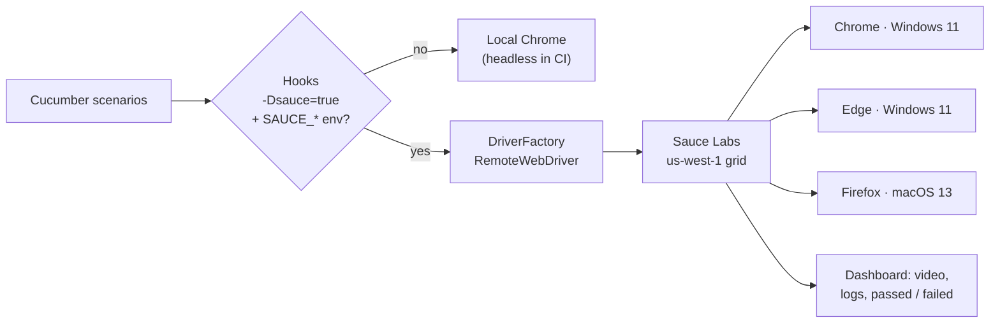

<div align="center">

# ☁️ QA Brains Automation — Sauce Labs Cloud

### Selenium + Cucumber suite that runs on local headless Chrome or on the Sauce Labs cloud grid

[](https://git.io/typing-svg)

<!-- ============ STATUS BAR ============ -->
[](https://github.com/rbchy/QaBrainsSauceLabAPI_Automation/actions/workflows/tests.yml)


</div>

---

## 📌 At a Glance

<table>
<tr>
<td width="50%" valign="top">

**🙋 What this is**

The **cloud edition** of the QA Brains practice-site suite. The same 15 Cucumber scenarios — authentication, the e-commerce cart and menu navigation — run either on a **local headless Chrome** or on **[Sauce Labs](https://saucelabs.com/)** virtual machines, switched with one flag. On Sauce Labs every scenario becomes a named job with **video, screenshots and logs**, marked passed or failed in the dashboard.

> *Write the test once; choose the browser farm at run time.*

</td>
<td width="50%" valign="top">

**📍 Quick facts**

| | |
|---|---|
| 🧪 **Scenarios** | 15 in 7 feature files |
| ✅ **CI (local)** | 15 / 15 · headless Chrome |
| ☁️ **CI (cloud)** | Chrome + Edge on Windows 11, Firefox on macOS |
| 🔐 **Credentials** | Environment variables / GitHub secrets only |
| 📸 **On failure** | Screenshot + page HTML; Sauce video |

</td>
</tr>
</table>

---

## ✅ Latest Results

| Target | How | Result |
|---|---|---|
| 💻 Local headless Chrome | `mvn test -Dheadless=true` |  |
| ☁️ Sauce Labs matrix | `mvn test -Dsauce=true` |  |

The Sauce Labs matrix is wired into [the workflow](.github/workflows/tests.yml) and starts running for real as soon as the `SAUCE_USERNAME` and `SAUCE_ACCESS_KEY` repository secrets exist; until then those jobs only print a notice. Earlier cloud runs (29 Apr 2026, *QAbrains Build*, Chrome 147) are in the Sauce Labs dashboard exports in this repository, e.g. [all results](Automated%20_%20Test%20Results%20_%20Sauce%20Labs_all.pdf) and [passed](Automated%20_%20Test%20Results%20_%20Sauce%20Labs_passed.pdf).

---

## ☁️ Running on Sauce Labs



**1. Credentials — environment variables only, never in code:**

```bash
export SAUCE_USERNAME="your-username"
export SAUCE_ACCESS_KEY="your-access-key"
```

**2. Run:**

```bash
mvn clean test -Dsauce=true                                   # Chrome latest, Windows 11
mvn clean test -Dsauce=true -Dsauce.browser=firefox -Dsauce.platform="macOS 13"
mvn clean test -Dsauce=true -Dsauce.build="Release 1.2"       # group jobs under a build name
```

**3. In GitHub Actions:** add `SAUCE_USERNAME` and `SAUCE_ACCESS_KEY` under **Settings → Secrets and variables → Actions**; the three-browser matrix then runs on every push, one Sauce build per workflow run.

---

## 🎯 Test Coverage

<details open>
<summary><strong>🔐 Authentication</strong></summary>

<br>

| Feature | Scenarios |
|---|---|
| Login | Valid credentials · invalid credentials show *"Your email and password both are invalid!"* |
| Logout | A logged-in user logs out and the login form returns |
| Registration | Register with a valid e-mail · the browser rejects an e-mail without `@` |
| Forgot Password | Reset for a registered e-mail · a malformed e-mail is rejected |

</details>

<details>
<summary><strong>🛒 E-commerce demo &amp; 💨 smoke</strong></summary>

<br>

| Scenario | Check |
|---|---|
| Add / remove product | The button toggles between *Add to cart* and *Remove from cart* |
| R-01 Add multiple products | 3 added → 3 in the cart |
| R-02 Product details | Details page shows name and price |
| R-03 Product cards | Every card has a name, a price and an *Add to cart* button |
| S-01 · S-02 · S-03 | Home page loads; sidebar modules and the E-Commerce site open from the menu |

</details>

---

## 🛠️ Tech Stack

| Layer | Technology | Version |
|---|---|---|
| Language | Java | 17 |
| Browser automation | Selenium WebDriver (`RemoteWebDriver` for the cloud) | 4.25.0 |
| Cloud grid | Sauce Labs (W3C `sauce:options`) | — |
| Driver management | WebDriverManager (local Chrome) | 5.7.0 |
| BDD · runner | Cucumber 7.15 · TestNG 7.9 | — |
| Build | Maven (Surefire 3.2.5) | — |
| CI | GitHub Actions: local job + Sauce matrix | — |

---

## 📁 Project Structure

```
QaBrainsSauceLabAPI_Automation/
├── .github/workflows/tests.yml        ← local headless job + Sauce Labs browser matrix
├── src/test/java/
│   ├── pages/                         ← Login, Logout, Registration, ForgotPassword, Ecommerce
│   ├── stepdefinitions/
│   │   ├── Hooks.java                 ← local or Sauce driver, failure evidence, Sauce job result
│   │   ├── CommonSteps · AuthSteps · RegistrationSteps · ForgotPasswordSteps
│   │   └── ShopSteps.java             ← cart, product details, menu navigation
│   ├── runners/TestRunner.java
│   └── utils/
│       ├── BaseTest.java              ← config, local Chrome, headless switch
│       └── DriverFactory.java         ← Sauce Labs RemoteWebDriver (env-var credentials)
├── src/test/resources/
│   ├── config.properties              ← URL, practice accounts, headless, sauce
│   └── features/                      ← 7 feature files, 15 scenarios
├── Automated _ Test Results _ Sauce Labs_*.pdf
└── pom.xml
```

---

## ⚙️ Running Locally

**Prerequisites:** JDK 17+ · Maven 3.8+ · Google Chrome

```bash
git clone https://github.com/rbchy/QaBrainsSauceLabAPI_Automation.git
cd QaBrainsSauceLabAPI_Automation

mvn clean test                                    # local Chrome
mvn clean test -Dheadless=true                    # what the CI local job runs
mvn clean test -Dcucumber.filter.tags="@Cart"     # one area
```

Reports: `target/cucumber-reports.html` · `target/cucumber-reports/` (JSON, JUnit XML) · `target/failures/` (page HTML of failed scenarios).

---

## 🧹 Maintenance Log

| Change | Why |
|---|---|
| **Removed the hard-coded Sauce Labs username and access key** from `DriverFactory`; credentials now come only from environment variables / GitHub secrets | The key was readable by anyone in a public repository. It remains in git history, so it **must be regenerated in Sauce Labs** (User Settings → Access Key) |
| Added step definitions, hooks and the Login / Logout / ForgotPassword / Ecommerce pages | None were in the repository — the suite could not run |
| Cart, smoke and regression scenarios rewritten for the site's real e-commerce demo and menu | The old ones (catalog, blog, wishlist, search) belong to another shop |
| Sauce jobs are marked passed / failed in the dashboard | Sauce shows every job as *Complete* unless told the result |
| Unused `SearchPage` and `DriverHelper` (Windows-only driver path) removed | Dead code |
| GitHub Actions: local job + Sauce matrix | Every push is checked; the cloud runs start once secrets are added |

---

## 📈 Roadmap

- [x] Credentials out of code; local and cloud modes
- [x] GitHub Actions with a Sauce Labs browser matrix
- [ ] Add the Sauce Labs secrets and record the first matrix run
- [ ] Parallel scenarios on Sauce Labs (`ThreadLocal` driver + TestNG data provider)
- [ ] Mobile web on Sauce Labs virtual Android / iOS devices

---

## 🔗 Related Projects

| Project | Stack |
|---|---|
| 🧪 [QA Brains — Java + Selenium](https://github.com/rbchy/QaBrainsAutomationJavaSelenium) | Same scenarios, local only — CI green |
| 🎭 [QA Brains — Java + Playwright](https://github.com/rbchy/QaBrainsAutomationJavaPlaywright) | Same scenarios on Playwright — CI green |
| 📱 [Appium Android Automation](https://github.com/rbchy/AppiumTest_Andriod_Automation) | Appium 3 on an Android emulator in CI, optional Sauce Labs |
| ⭐ [RbcTcsWorld E-Commerce Suite](https://github.com/rbchy/RbcTcsWorld_ECommerceSuite) | Spring Boot · Selenium · Playwright · CI quality gates |

<sub>All projects: [github.com/rbchy](https://github.com/rbchy)</sub>

---

## 👤 Author

<div align="center">

**Ranajit Baran Chowdhury (RB Chowdhury)**
QA Automation Engineer / SDET · West Norriton, Pennsylvania, USA

[](https://www.linkedin.com/in/rbchy/)
[](https://github.com/rbchy)
[](https://rbchy.github.io/rbchy/)
[](https://rbc6543.wixsite.com/rbc-portfolio)
[](mailto:chyranajit@gmail.com)

<sub>Licensed under MIT. Never commit Sauce Labs credentials — use environment variables or repository secrets.</sub>

⭐ *If this framework helps you, a star on the repo is appreciated.*

</div>
